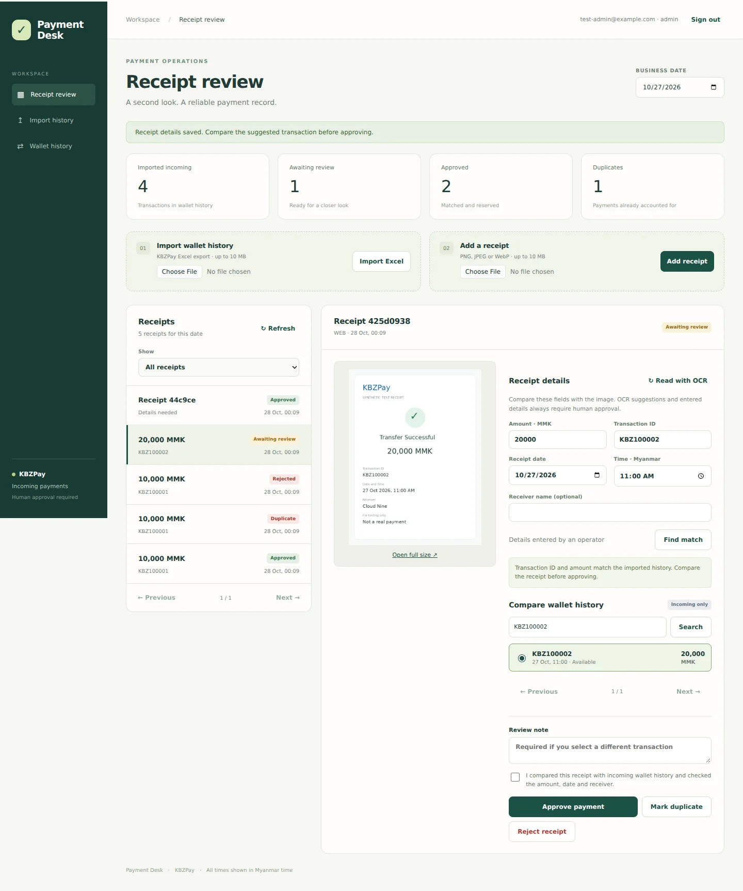
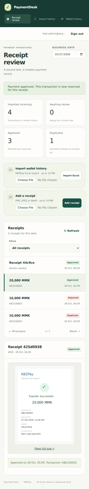

# MVP verification — 28 October 2026

## Scope

KBZPay Excel import → private screenshot → OCR suggestions or manual receipt details → compare incoming transactions → explicit human approval/rejection/duplicate → database reservation and audit log.

## Executed locally

| Check | Result |
|---|---|
| Prisma schema validation | Passed |
| NestJS production build | Passed |
| Unit tests | 27 passed across 9 suites |
| HTTP integration and browser subtests | 14 passed (Node test runner reports 15 including the parent test) |
| Competing screenshots for one transaction | One approved, one HTTP 409 |
| Competing transactions for one screenshot | One approved, one HTTP 409 |
| Missing OCR configuration | Remains in manual review with an actionable reason |
| Refresh-token rotation | New token issued; previous refresh token rejected |
| Desktop browser, 1440 px | Login → find match → approve → navigation → sign out passed |
| Mobile browser, 390 px | No horizontal overflow; approved receipt and wallet navigation passed |
| Browser JavaScript errors | None during the tested journey |
| Git whitespace validation | Passed |

Local integration tests used PostgreSQL-compatible PGlite with the generated SQL migrations and the real Prisma client. Connections were limited to one in this embedded test runtime. GitHub Actions is configured to repeat the integration suite against PostgreSQL 16 with its normal connection pool; its result must be checked on the PR.

The browser ran against the real NestJS API and persisted test data. The Google Vision port was replaced with an explicit synthetic OCR adapter in integration tests. No real provider credentials, Google Vision request, Telegram webhook, production deployment, or Docker build was exercised in this environment. The screenshots below contain synthetic payment data, not real transactions.

## Visual checks

## Before a live pilot

Configure HTTPS, PostgreSQL, persistent private storage and a private administrator account. Import a real KBZPay export and validate representative real screenshots with the intended wallet receiver. Google Vision and Telegram credentials are optional when operating through manual web upload and entry. Keep approvals manual while collecting provider-format evidence.
